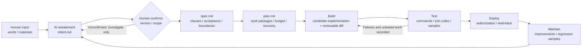

# Pre-flight · 起飞

[简体中文](README.md) | **English**

**Start with human intent. Establish the project foundation. Let AI carry the work toward verifiable delivery.**

Pre-flight is a portable skill for coding agents. Describe what you want in your own words; the agent helps establish the project's basic law, define success, and then plan, build, verify, and hand over the work. It supports new projects and incremental adoption in existing ones.

## Start your first project

Use an AI development tool that can read files and carry out development work. Prepare two locations:

- **Skill folder**: holds this reusable method and can serve multiple projects.
- **Project folder**: holds your product. Choose a separate empty folder for each new project.

### 1. Download the skill

On this repository page, select **Code → Download ZIP** and extract it. Keep the complete `pre-flight/` folder, including `SKILL.md` and its supporting files.

Install it in your tool's supported skill directory following that tool's instructions, or save it somewhere convenient and give the agent its path. Automatic discovery is optional.

### 2. Choose a project location

For example, store the skill at `/your-path/skills/pre-flight` and the project at `/your-path/projects/my-new-project`. Replace these with actual paths. The project directory should be absent or empty to avoid overwriting existing work.

### 3. Give the agent this prompt

```text
Read /your-path/skills/pre-flight/SKILL.md first.
Create a new project at /your-path/projects/my-new-project.
My idea is: [describe whose problem you want to solve, in your own words].
Help me clarify my intent and establish the project's basic law in plain language.
Restate a candidate intent and wait for my confirmation of that restatement
before accepting it as a formal Intent. Write shared rules in AGENT.md,
then create a readable Spec and actionable Plan.
Ask about critical gaps, investigate what you can independently,
and respect authorization I have already given.
For now, complete the foundation and planning, explain pending decisions,
and proceed with development under subsequent authorization.
```

If you already want continuous implementation, replace the last sentence with: “After establishing the foundation and plan, continue implementation, verification, and delivery within my existing authorization.” Tools supporting named skill invocation can also use `$pre-flight`.

### 4. Understand your project foundation

| What you need to know | Where it lives |
|---|---|
| Project basic law: purpose, principles, boundaries, agent rules, and rule changes | `AGENT.md` |
| Basic-law amendment records and evidence | `docs/sdlc/maintain/basic-law-log.md` |
| Safety red lines and local/CI checks | AGENT.md "Safety red lines" section; optional `scripts/ci-check.sh` |
| What I want and why | `docs/sdlc/plan/intent.md` |
| How the product should behave and what success means | `docs/sdlc/design/spec.md` |
| Work packages, verification, and recovery | `docs/sdlc/build/plan.md` |
| Current progress and next steps | `STATUS.md` |
| Evidence, delivery, and follow-up issues | `docs/sdlc/test/`, `deploy/`, `maintain/` |

You do not need to memorize these filenames. The agent should first explain purpose, success criteria, progress, and decisions in plain language, with technical detail available when needed. Initialization creates drafts; discussion and verification establish the actual foundation.

## Workflow and expectations

The method is a revisit-friendly loop: implementation starts only after the intent restatement is confirmed, and every stage leaves checkable evidence; changes return as the next candidate intent.



<details><summary>Plain-text version (for hosts without Mermaid)</summary>

```text
human input ──▶ AI restatement (intent.md) ──▶ ★human confirms (version/scope) ──▶ formal Intent
                                                │ if unconfirmed: investigate / draft only
                                                ▼
intent ──▶ spec (clauses/acceptance/boundaries) ──▶ plan (packages/budget/recovery) ──▶ Build (candidate + reviewable diff)
   ▲                                                                                        │
   │                                                                                        ▼
Maintain (improvements/regression) ◀── Deploy (authorization/read-back) ◀── Test (commands/exit codes/samples)
```
</details>

**Implementation steps: six stages × artifacts × human decisions × evidence**

| Stage | Artifacts | Human decides / confirms | Evidence (none alone is enough) |
|---|---|---|---|
| Plan: intent | intent.md: words, AI restatement, assumptions, open items | Confirm the restated intent and success criteria | Confirmation record: version, time, scope |
| Design | spec.md: clause IDs, boundaries, acceptance | Scope tradeoffs, acceptance basis, non-goals | Each requirement independently verifiable; frozen version |
| Build | plan.md: work packages, budget, stop conditions; candidate implementation | Key tradeoffs, necessary authorization | Reviewable diff; targeted verification results |
| Test | verification records: commands, environment, samples, exit codes | Accept the implementation against the frozen Spec | Failures, skips and untested areas listed honestly |
| Deploy | Delivery receipt: artifact identity, applicable authorization, read-back | Actual authorization for release and production writes | Report activation only after reading back the live environment |
| Maintain | Improvements, new intent candidates, regression samples | Next goals and priorities | Issues close into a work item or an intent revision |

Stages are a loop, not a waterfall: a small fix can put restatement, change, verification and recovery in one work item; six documents are not mandatory.

**Token and cost basis (for estimation, not a promise)**

| Cost source | What it maps to here | How to reduce it | What to record |
|---|---|---|---|
| Resident context | AGENT.md, STATUS, skill guidance kept in the prompt | Keep the body lean: identity, rules, real commands, navigation | Before/after size; check on handover |
| Dynamic material | Spec, source, data and logs loaded per work package | Provide only what the current decision needs; cite versions instead of dumping everything | What was cited and loaded |
| Tool output and retries | Long logs, failed reruns, unknown effects | Prefer targeted verification; reconcile read-only before replaying unknown effects | Commands, exit codes, retry reasons |
| Model routing | Triage/search/drafting vs design/root cause/review | Cheaper models for low-risk work; stronger models for key decisions | Actual use and quality sampling |
| Prefix caching | Stable rules, templates, checklists | Put fixed content first and the changing question last | Cache hits and response changes, if measurable |
| Evals and samples | Evals, regression samples, failure reproductions | Freeze samples with independent criteria; reuse instead of rebuilding | Sample versions, pass lines, variance |

Return ratio: return ratio = (hours saved + value of rework and defects avoided) ÷ (token + tools + maintenance cost). Fill it in from one completed work package; untested gains stay candidate assumptions, not performance commitments, and other people's ratios are not adopted as ours.

**Expected maintenance cost profile (directional, not a numeric promise)**

| Cost item | One-off prototype / intuition-led coding | Engineered with this package | Evidence to review |
|---|---|---|---|
| Upfront | Almost no rules, acceptance or plan | Higher upfront: basic law, Spec, Plan, tests and checks | Upfront artifact list and effort |
| Requirement change | Verbal changes patched in code; heavy rework | Candidate Intent → restatement and confirmation → new Spec version | Change record and affected scope |
| Defects and regression | No tests, or tests drift with the implementation; repeated firefighting | Failures become regression samples; old tests are marked with their identity | Failure samples and regression results |
| Knowledge handover | Scattered in chat; the next person asks again | AGENT.md, STATUS, artifacts and amendment records support handover | Handover checklist result |
| Permissions and safety | Fixed afterwards | Safety red lines and check entry points come first | Check records and authorization boundaries |
| Long-term trend | More scale, more cost | More reuse, lower cost per delivery (directional; measure it) | Cost and reuse data over time |

Conclusion: upfront engineering is amortized during maintenance through reuse and regression; whether it pays off depends on project scale, maintenance lifetime and risk. Do not buy long-term maintenance for a one-off prototype that has no acceptance criteria or rules.

> The diagram and three tables are redrawn for this project's six stages and artifacts; the framing draws on common industry training material about roadmaps, TCO curves and token economics. Its experience numbers are illustrative, not measured by this package and not performance commitments; fill them from your own measurements.

## My perspective on AI

These principles summarize the originator's requirements in the design discussion, with AI-assisted writing.

1. **Intent must be established together.** A person's initial words are input. AI must guide clarification and restate a candidate; only after the person confirms that restatement does it become a formal Intent. Material changes require a new restatement and confirmation. Reuse an existing confirmed version without asking at every step. AI should understand what I want, why it matters, and what success means. My words, the agent's interpretation, and unresolved assumptions should remain distinguishable. Specs should be readable and actionable. Mid-run interruptions and supplementary requests get the same treatment: judge the type first — clarification, operational instruction, functional/scope/acceptance change, or rule/authorization-boundary change. Mixed or ambiguous requests take the higher category; for functional, scope, or acceptance changes, restate a candidate Intent change and confirm it before changing the baseline or building it, rather than overriding what was already confirmed.
2. **AI should carry work forward.** I expect planning, execution, verification, and continuity. Another agent should understand completed and remaining work from shared records, reducing repeated explanations and rework.
3. **Completion needs evidence.** A plan, generated code, or a successful save does not prove success. Agreed requirements, implementation acceptance, and activation need separate records. Failures, unknowns, and untested areas should remain visible.
4. **The method should travel across agents.** Shared rules live in `AGENT.md`, with thin tool-specific entry files where needed. Durable project records support handovers. Core clauses carry stable IDs; amendments need an amendment record and explicit human confirmation, with the previous version kept.
5. **Engineering discipline should be human-friendly.** People should first see intent, success criteria, progress, and decisions needing attention. Scale the process to the work and respect existing authorization. People direct goals, key tradeoffs, and necessary permissions.

## Combining the two references

This project combines Louis Claxton / Anthropic's *The AI-Native SDLC Playbook* with Addy Osmani, Shubham Saboo, and Sokratis Kartakis's *The New SDLC With Vibe Coding: From ad-hoc prompting to Agentic Engineering* (May 2026, the Google AI SDLC material supplied by the user).

- The Playbook supplies the **Plan → Design → Build → Test → Deploy → Maintain** lifecycle, artifacts, and feedback loops.
- *The New SDLC* adds **context engineering, the harness surrounding the model, tests and evals, prototype-to-production rigor, and total cost of ownership**.
- Pre-flight adapts these into a host-independent method. The project's basic law, human-facing presentation, and version/activation semantics are package adaptations. Reference authors' views are not attributed to the originator.

See the [method notes](pre-flight/references/method-basis.md) for page references and explicit adaptations.

## Scope and compatibility

`AGENT.md` is this method's shared guide. The default `AGENTS.md` and optional `CLAUDE.md` and `GEMINI.md` entry files point to it. Automatic loading depends on the tool; verify that the agent actually reads the guide.

A skill provides guidance. Enforced checks and permissions need actual scripts, CI, and host settings. Scale verification to prototype or production risk. Add model-behavior evals when the product contains such behavior or when evaluating the development agent. Small changes can use lightweight records. The package includes an optional safety baseline and host-neutral check scripts (a local git hook and a CI entry point; not tied to GitHub or any single platform). Hooks and CI can be bypassed; real gates still require server-side branch protection, review, and permissions.

## Manual initialization (optional)

Usually the agent can handle this. To create the documents manually, run from the repository root, previewing first:

```sh
python3 pre-flight/scripts/init_project.py --target ./my-new-project --project-name "My Project"
python3 pre-flight/scripts/init_project.py --target ./my-new-project --project-name "My Project" --apply
```

The default entry file is `AGENTS.md`; use `--adapters agents,claude,gemini` or `--adapters none` as needed. The script creates documents in a new empty directory; application development remains subsequent work. Existing projects require inspection and incremental adoption.

## Contents and license

[Skill entry](pre-flight/SKILL.md) · [Workflow and references](pre-flight/references/) · [Project templates](pre-flight/assets/project-template/) · [Validation scope](VALIDATION.md)

Original package content is [MIT licensed](LICENSE). Source PDFs are not distributed. This project is not affiliated with the reference authors or vendors. Cross-client agent behavior and automatic discovery have not been validated end to end.
