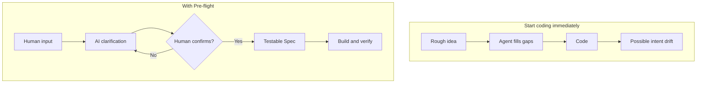
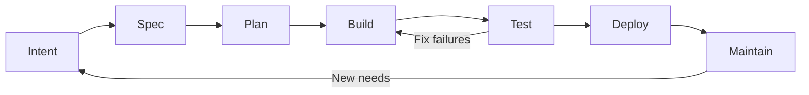

# Pre-flight · 起飞

**Make sure the agent understands the destination before it starts coding.**

[简体中文](README.md) · [Skill](pre-flight/SKILL.md) · [Validation](VALIDATION.md)

> A portable AI-native SDLC skill for coding agents. Turn human ideas into confirmed Intent, testable Spec, and actionable Plan—with traceable implementation, verification, delivery, and handover.

## Why Pre-flight?

Coding agents can generate code quickly. But **generated code is not the same as the product you intended**. Critical assumptions can go unspoken, mid-task changes can overwrite decisions, and the next agent may need to reconstruct context from chat history.

Pre-flight is not another coding agent or a promise of automatic productivity gains. It is an engineering method that keeps **human decisions, agent execution, and verifiable evidence** distinct.

### Two paths from idea to implementation



*This diagram illustrates decision paths, not measured A/B performance.*

## What it does

**Clarify intent.** Preserve the difference between the user's words, the agent's interpretation, and open assumptions. A formal Intent requires traceable human confirmation; already-confirmed decisions are not repeatedly re-approved.

**Define done.** Specs contain stable requirement IDs, boundaries, counterexamples, and independent acceptance criteria. Plans break work into verifiable and recoverable packages.

**Support continuity.** `AGENT.md` holds shared project rules; `STATUS.md` holds current state. Versioned Intent, Spec, Plan, and verification records let another agent continue from inspectable project facts.

**Keep claims honest.** Protected basic-law clauses have optional hash checks and an amendment process. Implementation, test acceptance, and deployment activation are separate states.

### A traceable development loop



This is **not** a requirement to create seven documents for every fix. Small fixes can use one concise work item; higher-risk changes need stronger evidence and authorization.

## Get started

1. Download the repository ZIP and keep the entire `pre-flight/` directory, or install it in your agent tool's supported skills directory.
2. Choose an empty folder for a new project. For an existing project, inspect it first; do not overwrite its files with templates.
3. Give your agent this prompt, replacing the paths and idea:

```text
Read /your/path/pre-flight/SKILL.md first.
I want to start a project in /your/path/my-project.
My idea is: [describe the problem and desired outcome].

Clarify and restate my intent, distinguishing my words, your interpretation,
and unresolved assumptions. Wait for my confirmation before accepting Intent.
Then prepare a human-readable Spec and actionable Plan.
Tell me which decisions require my input. For now, stop after the project
foundation and plan; do not implement or deploy beyond confirmed scope.
```

You may separately authorize continued development. Named-skill invocation (such as `$pre-flight`) and automatic loading depend on the host.

### What remains in the project?

```text
my-project/
├── AGENT.md                       # Shared rules and basic law
├── STATUS.md                      # Current progress and next steps
└── docs/sdlc/
    ├── plan/intent.md             # Confirmed human goals and provenance
    ├── design/spec.md             # Testable requirements
    ├── build/plan.md              # Work packages and recovery
    ├── test/verification.md       # Actual evidence and gaps
    ├── deploy/delivery.md         # Delivery and activation evidence
    └── maintain/                  # Maintenance and amendments
```

Initialization creates **drafts**, not confirmed goals, working code, or verified delivery.

## Real-world application: DSH Orchestrator

[DSH Orchestrator](https://github.com/8778fkv694-hub/dsh-orchestrator) is a public project using this methodology. Its [status](https://github.com/8778fkv694-hub/dsh-orchestrator/blob/main/STATUS.md), [specification](https://github.com/8778fkv694-hub/dsh-orchestrator/blob/main/docs/sdlc/design/spec.md), and [verification record](https://github.com/8778fkv694-hub/dsh-orchestrator/blob/main/docs/sdlc/test/verification.md) provide inspectable examples of versioned requirements and reported test evidence.

**Evidence boundary:** DSH project tests do not constitute a controlled benchmark proving Pre-flight improves coding efficiency or works across all agents. See [VALIDATION.md](VALIDATION.md) for what has and has not been verified.

## Principles at a glance

| Principle | Practical contract |
|---|---|
| Humans own goals | Confirm an AI-restated Intent before formal acceptance |
| Agents execute within authorization | Ask humans for material decisions, not every implementation detail |
| Done means testable | Connect Spec requirements to acceptance evidence |
| Rules should not silently drift | Stable clause IDs, amendments, optional checks |
| Handover should be possible | Shared project entry, STATUS, versioned artifacts |
| Generated is not delivered | Distinguish implementation, verification, and activation |

## Files and documentation

- [Skill entry](pre-flight/SKILL.md) and [references](pre-flight/references/)
- [Project templates](pre-flight/assets/project-template/) and [scripts](pre-flight/scripts/)
- [Validation scope](VALIDATION.md)
- [Background reading](background/whitepapers-zh/README.md) (not required to run the skill)

Optional manual initialization from the repository root (preview, then apply):

```sh
python3 pre-flight/scripts/init_project.py --target ./my-new-project --project-name "My Project"
python3 pre-flight/scripts/init_project.py --target ./my-new-project --project-name "My Project" --apply
```

**Limitations:** Skills and Markdown provide guidance, not OS-level permissions. Automatic discovery, CI, hooks, branch protection, and runtime behavior must be separately verified in the host and project.

## Sources and license

The method adapts ideas from *The AI-Native SDLC Playbook* and *The New SDLC With Vibe Coding*. See [method notes](pre-flight/references/method-basis.md) for attribution and adaptations.

Original work is [MIT licensed](LICENSE). Unofficial translations under `background/whitepapers-zh/` are not covered by MIT; original rights remain with their owners. This project is not affiliated with the cited authors or vendors.
