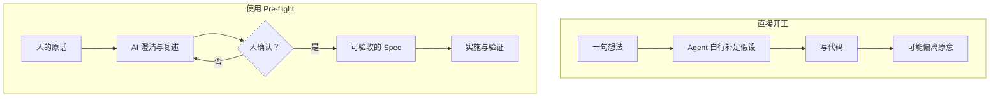
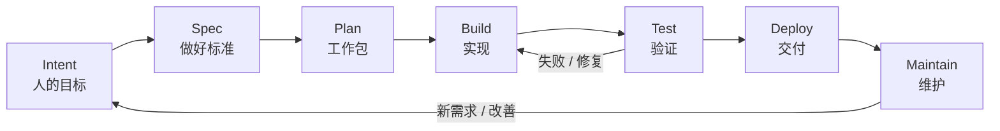

# 起飞 · Pre-flight

**让 AI 先理解你想做什么，再把事情做成。**

[English](README.en.md) · [Skill 入口](pre-flight/SKILL.md) · [验证记录](VALIDATION.md)

> 一个面向开发 Agent 的、可跨工具使用的 AI-native SDLC Skill。把人的想法转化为经过确认的 Intent、可验收的 Spec 和可执行的 Plan，让实现、验证、交付与下一位 Agent 的接手有据可查。

## 为什么需要它？

AI 写代码很快，但**代码写出来，不等于做成了你想要的东西**。问题常发生在开始编码之前：需求没有说透，Agent 自行补足了关键假设；改需求时覆盖了原来的决定；换一个 Agent，又得从聊天记录里重新解释。

Pre-flight 不试图替代编程 Agent，也不承诺让每个项目更快。它为 Agent 提供一套可重复使用的工程方法：**人的目标由人确认，实施细节尽量交给 Agent，完成情况用证据判断。**

### 一个关键区别：先确认目标，再推进实现



*示意图说明的是决策路径，不是经过 A/B 测试的效率结论。*

## 它具体做什么？

**1. 让人的意图有明确的归属。** 原话、Agent 理解、待确认假设分开记录。正式 Intent 必须有可回查的人类确认；已经确认的决定不在每一步反复询问。

**2. 让“做好”成为可检验的标准。** Spec 不是功能愿望清单，而是带稳定 ID、边界、反例和验收方法的要求。Plan 将要求拆成可验证、可恢复的工作包。

**3. 让项目能够长期接续。** `AGENT.md` 保存共同规则，`STATUS.md` 说明当前状态，Intent / Spec / Plan 和验证记录保留依据。不同 Agent 可以从同一项目事实继续工作，而不是依赖某段聊天上下文。

**4. 让规则变更和完成声明受到约束。** 核心基本法条款采用稳定 ID 与可选哈希检查；重要修改需要人确认。实现、测试通过、实际部署生效是不同的状态，不能混为一谈。

### 工程闭环：每一步都有下一步的依据



**不是每次都要写七份文档。** 小修复可以用一个工作项记录目标、修改、验证与恢复；新项目或高风险变更则需要更完整的依据。安全与操作授权不因流程简化而消失。

## 10 分钟开始使用

你只需要一个能读取文件并执行开发任务的 Agent。

1. 在 GitHub 点击 **Code → Download ZIP**，解压并保留完整的 `pre-flight/` 目录；或者将该目录安装到工具支持的 Skill 位置。
2. 准备一个新的空项目目录。已有项目请先让 Agent 检查现状，**不要直接用模板覆盖**。
3. 将下面这段话发给 Agent，并替换实际路径和你的想法。

```text
请先阅读 /你的路径/pre-flight/SKILL.md。
我要在 /你的路径/我的项目 开始一个项目。
我的想法是：[用自己的话描述问题和期望]。

先帮我澄清并复述意图，区分我的原话、你的理解和未决假设；
等我确认候选 Intent 后，再建立可读的 Spec 和可执行的 Plan。
请说明需要我决定的事项。当前先完成项目基础与规划，
不要在未经确认或授权的范围内实施、发布或修改已有项目资料。
```

如果你已明确授权继续开发，可让 Agent 在确认意图、建立计划后持续实施和验证。支持命名 Skill 的工具也可尝试 `$pre-flight`；实际自动加载能力取决于宿主。

### Agent 会留下什么？

```text
我的项目/
├── AGENT.md                       # 共同规则与基本法
├── STATUS.md                      # 当前进度、阻碍和下一步
└── docs/sdlc/
    ├── plan/intent.md             # 人确认的目标及其来源
    ├── design/spec.md             # 可独立验收的要求
    ├── build/plan.md              # 工作包、验证与恢复
    ├── test/verification.md       # 实际验证及未验部分
    ├── deploy/delivery.md         # 交付与环境生效证据
    └── maintain/                  # 维护与基本法修正记录
```

初始化只生成草稿，**不会自动证明目标已确认、代码已实现或项目已交付**。

## 真实项目：DSH Orchestrator

[DSH Orchestrator](https://github.com/8778fkv694-hub/dsh-orchestrator) 是应用这套方法的一个公开案例：它把 Intent、Spec、工作计划、测试证据和当前状态放在可检查的项目文件中。

| 可以查看的证据 | 能证明什么 | 不能据此证明什么 |
|---|---|---|
| [DSH 项目状态](https://github.com/8778fkv694-hub/dsh-orchestrator/blob/main/STATUS.md) | 项目公开记录了当前进度、验证范围和待办 | 所有环境、所有场景均可靠 |
| [DSH 规格](https://github.com/8778fkv694-hub/dsh-orchestrator/blob/main/docs/sdlc/design/spec.md) | 要求、版本与验收标准可追溯 | 每条要求都已经在生产环境验收 |
| [DSH 验证记录](https://github.com/8778fkv694-hub/dsh-orchestrator/blob/main/docs/sdlc/test/verification.md) | 已记录的测试方法与结果 | Pre-flight 相比其他方法的效率提升 |

**证据边界：** DSH 的项目测试是该项目的测试，不等于 Pre-flight 方法论本身通过了跨 Agent 对照实验。Pre-flight 的现有检查与未验证范围请看 [VALIDATION.md](VALIDATION.md)。

## 设计原则

| 原则 | 在项目里如何体现 |
|---|---|
| 人决定目标 | AI 复述候选 Intent，人的明确确认才使其正式生效 |
| Agent 自主完成已授权的工作 | 关键目标与权限决定才需要回到人 |
| 要求可验证 | Spec 条款关联验收办法和实现证据 |
| 规则不静默改写 | 基本法条款、修正记录和可选检查器 |
| 换 Agent 不重新开始 | 共同入口、STATUS 和带版本的工作资料 |
| 不把“生成了”当“完成了” | 分开记录实现、验证、部署与未知状态 |

## 项目结构与更多资料

- [`pre-flight/SKILL.md`](pre-flight/SKILL.md)：Agent 执行入口；参考资料按需读取。
- [`pre-flight/references/`](pre-flight/references/)：意图确认、流程、变更、基本法、安全与宿主适配。
- [`pre-flight/assets/project-template/`](pre-flight/assets/project-template/)：新项目文档模板。
- [`pre-flight/scripts/`](pre-flight/scripts/)：初始化和基本法检查脚本。
- [`VALIDATION.md`](VALIDATION.md)：本 Skill 已验证与未验证的范围。
- [`background/whitepapers-zh/`](background/whitepapers-zh/README.md)：背景阅读，不是执行 Skill 的必要部分。

手动初始化（在仓库根目录运行，默认先预览）：

```sh
python3 pre-flight/scripts/init_project.py --target ./my-new-project --project-name "我的项目"
python3 pre-flight/scripts/init_project.py --target ./my-new-project --project-name "我的项目" --apply
```

**边界说明：** Skill 和 Markdown 是方法指导，不是操作系统级权限控制。自动加载、CI、hook、分支保护及真实运行能力必须在使用的宿主与项目中单独验证；不应把文档声明当作已生效的门禁。

## 方法来源与许可

方法借鉴 *The AI-Native SDLC Playbook* 与 *The New SDLC With Vibe Coding* 的工程生命周期、上下文工程和验证思想，并针对人的意图确认、跨 Agent 接续和版本证据作了适配。[查看方法依据](pre-flight/references/method-basis.md)。

原创内容采用 [MIT 许可](LICENSE)。`background/whitepapers-zh/` 中的非官方译文不属于 MIT 授权范围，原文版权归相应权利人。本项目与相关作者及厂商无隶属关系。
