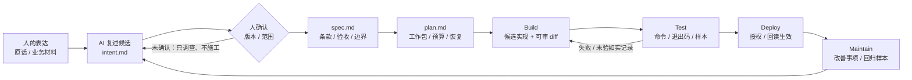

# 起飞 · Pre-flight

**简体中文** | [English](README.en.md)

**从人的意图出发，建立项目基础，让 AI 持续推进到可验证的交付。**

“起飞”是一套可以交给开发 Agent 使用的通用 Skill。你先用自己的话说想做什么，它帮助你建立项目的基本法、写清做好标准，再规划、开发、验证和交接。适用于全新项目，也支持已有项目逐步采用。

## 两套 Skill：基础版与增强版

本仓库提供**两套可独立选择的 Skill**。增强版不是替换基础版，不是额外的审批引擎，也不要求每个任务同时运行两个 Skill。

| 选择 | Skill 入口 | 适合任务 | 重点 |
|---|---|---|---|
| **起飞 · 基础版** | [`pre-flight/SKILL.md`](pre-flight/SKILL.md) | 新项目初始化、意图确认、Spec/Plan、常规开发与交付 | 六阶段工程闭环、清晰规则和验证证据 |
| **起飞 · 增强版** | [`pre-flight-enhanced/SKILL.md`](pre-flight-enhanced/SKILL.md) | 问题复杂、信息不全、需要 Agent 主动推进或可靠接续的任务 | 在基础方法上加强主动补位、评估决策、纠错与行为验证 |

**共同基础**：人的目标和关键取舍由人确定；已确认的 Intent 不反复确认；Agent 在既有授权内主动执行；真实操作须遵守实际权限与安全约束。增强版复用基础版的 Intent/Spec/Plan、六阶段、Lite/Standard/Strict 风险分级和受保护的基本法条款，**不另造第二套项目规则**。基本法原则保持稳定；如何调查、放行、纠正与评测，可以依据证据持续改进。

### 增强版到底增强什么？

**先帮助人完成目标，再考虑是否需要增加流程。** 不是要求 AI 背诵“诚实、主动、安全”六项口号，而是让它对真正影响目标的问题采取正确行动：

```text
人的已确认目标 + 现有授权
          ↓
主动理解情境、发现重要遗漏、核对现实证据
          ↓
判断：当前最有价值且被允许的下一步是什么？
          ├─ PROCEED：已有依据且符合授权 → 放行并执行
          ├─ INVESTIGATE：关键事实不足 → 有限调查后重评
          ├─ ESCALATE：目标取舍或新增授权 → 请人决定
          ├─ HOLD：危险/冲突/副作用不明 → 暂停受影响动作
          └─ CORRECT：实际失败/偏差 → 修复并重新验证
          ↓
检查实际结果；必要时纠正，并留下可交接的证据
```

这不是每次都执行的固定“五步审批”。普通已授权的小修复可以直接完成；只有信息、风险、授权或实际结果足以影响下一步时才重新评估。**信息并非越多越好**：继续调查不能改变当前决定时，应停止无效探索；未涉及的授权和风险边界也不能靠模型自信越过。

增强版着重同时防止两种失败：**错误放行**（不该做却做了）与**错误阻断**（本可继续却无故停下）。评测还观察有没有发现真正重要的遗漏、减少不必要的人为干预、如实报告失败并完成修复。详见 [12 个行为评测场景](pre-flight-enhanced/references/behavior-evaluation.md)；这些是**评测设计，尚非已经运行通过的成绩**。

### 如何安装和调用增强版

下载本仓库 ZIP 后，**增强版保留完整的 `pre-flight-enhanced/` 目录，基础版保留完整的 `pre-flight/` 目录**。两者应放在同一个父目录下，因为增强版需要按需引用基础版参考文件；不要只复制增强版单独一个 `SKILL.md`。

把对应目录放进你的 Agent 工具支持的 Skills 路径，或直接告诉 Agent 真实的文件路径。自动发现与命名调用是否支持，取决于具体工具。

```text
请先读取 /你的目录/技能/pre-flight-enhanced/SKILL.md。
它与同级的 pre-flight/ 基础版一起使用，按需读取基础版参考资料，
遵守项目原有 AGENT.md、Intent、Spec、Plan 和实际授权边界。

我要完成的目标是：[描述真实任务]。
请先检查当前状态和已有证据，主动发现会影响目标的重要信息缺口；
可以自主解决的直接调查、执行并验证，不要反复要求我确认已经授权的事情。
只有出现目标取舍、必要新增授权或无法独立解决的关键问题时，
请把事实、选项与建议交给我决定。
不要因为非关键未知而无限分析，不要擅自扩大范围；
完成后告诉我哪些结果经过实际验证、哪些仍未验证。
```

支持技能名称调用的工具，可根据其规则尝试 `$pre-flight-enhanced`；这不是所有客户端通用的指令语法。

**选择建议**：新项目起步或常规工程治理优先基础版；任务执行复杂、经常出现信息缺口、重复确认、Agent 接续或“代码写完但事情没办成”时优先增强版。增强版依然只是 Skill 指导文本，**不能保证模型已经形成判断力**，也不能代替宿主级权限、测试或真实环境核验。

## 仓库结构

- `pre-flight/` — 基础版 Skill，入口 [SKILL.md](pre-flight/SKILL.md)。
- `pre-flight-enhanced/` — 增强版 Skill，入口 [SKILL.md](pre-flight-enhanced/SKILL.md)，按需引用基础版。
- `background/whitepapers-zh/` — 背景资料：几份公开白皮书的中文精译，**非方法正文**，需要时再读。
- `VALIDATION.md` — 当前验证范围与记录。

选择基础版时只需 `pre-flight/`；选择增强版时保留两个同级 Skill 目录。背景资料不影响方法执行。

## 第一次创建项目，从这里开始

你需要一个能够读取文件和执行开发工作的 AI 工具。先准备两个位置：

- **技能目录**：存放“起飞”这套方法，可以被多个项目复用。
- **项目目录**：存放你要做的产品，每个新项目用自己的空文件夹。

### 1. 下载技能

在本仓库页面点击 **Code → Download ZIP** 并解压。保留完整的 `pre-flight/` 文件夹，里面的 `SKILL.md` 是入口，其他文件也需要一起保留。

可以将它放进工具支持的技能目录，按该工具的实际说明安装；也可以先放在你容易找到的位置，直接把路径告诉 Agent。无需先配置自动发现。

### 2. 选定新项目位置

例如，将技能放在 `/你的目录/技能/pre-flight`，将新项目放在 `/你的目录/项目/我的新项目`。请换成你电脑上的真实路径。项目目录应当尚不存在或为空，避免覆盖已有文件。

### 3. 复制这段话给 Agent

```text
请先读取 /你的目录/技能/pre-flight/SKILL.md。
我要在 /你的目录/项目/我的新项目 创建一个新项目。
我的想法是：[用自己的话描述想为谁解决什么问题]。
请先帮助我理解和整理意图，用通俗语言协助建立项目基本法，
先复述候选意图，等我确认这份复述后才纳入正式 Intent。
把共同规则写入 AGENT.md，再形成可读的 Spec 和可执行的 Plan。
关键缺口请问我，能独立调查的继续调查；沿用我已经给出的授权。
当前先完成项目基础和规划，向我说明待决定事项，再按后续授权开发。
```

如果你已经明确要求它持续开发，可以把最后一句改为：“完成基础与规划后，在我已授权的范围内继续实施、验证和交付。”支持技能名称调用的工具，也可以使用 `$pre-flight`。

### 4. 看懂它给你的项目基础

| 你关心的事 | 项目里放在哪里 |
|---|---|
| 项目的基本法：目的、原则、边界、AI 工作规则、如何修改规则 | `AGENT.md` |
| 基本法修正记录与依据 | `docs/sdlc/maintain/basic-law-log.md` |
| 安全红线与本机/CI 检查 | `AGENT.md`「安全红线」；可选 `scripts/ci-check.sh` |
| 我到底想做什么，为什么做 | `docs/sdlc/plan/intent.md` |
| 产品应当怎样工作，怎样算做好 | `docs/sdlc/design/spec.md` |
| 分几步做，每步怎么验证和恢复 | `docs/sdlc/build/plan.md` |
| 现在做到哪里，接下来做什么 | `STATUS.md` |
| 实测、交付与后续问题 | `docs/sdlc/test/`、`deploy/`、`maintain/` |

你不必先掌握这些文件名。Agent 应先用你能理解的语言说明目的、做好标准、进度和需要你决定的事，技术细节按需展开。文件会随着讨论和验证逐步完善，初始化只建立草稿。

## 开发流程与预期

方法是一条可回退的闭环：意图经人确认后才施工，每个阶段留下可核对的证据；变更回到下一个候选意图。



<details><summary>纯文本版（不支持 Mermaid 的宿主）</summary>

```text
人的表达 ──▶ AI 复述候选(intent.md) ──▶ ★人确认(版本/范围) ──▶ 正式 Intent
                                        │未确认：只调查 / 写候选草案
                                        ▼
intent ──▶ spec(条款/验收/边界) ──▶ plan(工作包/预算/恢复) ──▶ Build(候选实现+可审 diff)
  ▲                                                                        │
  │                                                                        ▼
Maintain(改善事项/回归) ◀── Deploy(授权/回读生效) ◀── Test(命令/退出码/样本)
```
</details>

**实施步骤：六阶段 × 工件 × 人的决定点 × 证据**

| 阶段 | 主要工件 | 人决定 / 确认的点 | 完成证据（缺一不算完成） |
|---|---|---|---|
| Plan 意图 | intent.md：原话、AI 复述、假设、未决 | 确认复述的意图与成功标准 | 确认记录：版本、时间、确认范围 |
| Design 设计 | spec.md：条款ID、边界、验收办法 | 范围取舍、验收口径、非目标 | 每条要求可独立验收；冻结版本 |
| Build 计划与实施 | plan.md：工作包、预算、停止条件；候选实现 | 关键取舍、必要授权 | 可审 diff；定向验证结果 |
| Test 验证 | verification 记录：命令、环境、样本、退出码 | 接受实现（对应冻结 Spec 版本） | 失败 / 跳过 / 未验如实列出 |
| Deploy 交付 | 交付收据：产物身份、适用授权、回读结果 | 发布、生产写入等实际授权 | 回读实际环境后才报告生效 |
| Maintain 维护 | 改善事项、新意图候选、回归样本 | 下一轮目标与优先级 | 问题闭环到工作项或意图修订 |

阶段是环，不是瀑布：小修复把复述、修改、验证与恢复写在同一工作项即可，不强制六份文档。

**Token 与成本口径（用于预估，不是承诺）**

| 成本来源 | 在本项目中对应什么 | 降低办法 | 记录方式 |
|---|---|---|---|
| 常驻上下文 | AGENT.md、STATUS、技能说明等常驻正文 | 正文保持精简，只留身份、规则、真实命令与导航 | 精简前后对比；接手时核对 |
| 动态材料 | 按工作包加载的 Spec、源码、数据、日志 | 只取当前决策点所需；引用版本而不是全库塞入 | 资料引用与加载范围 |
| 工具输出与重试 | 长日志、失败重跑、未知结果 | 定向验证优先；未知先只读对账，不盲目重放 | 命令、退出码、重试原因 |
| 模型分级 | 整理/检索/初筛 vs 设计/根因/评审 | 低风险任务用便宜模型，关键决定用强模型 | 实际使用与质量抽检 |
| 前缀缓存 | 稳定的规则、模板、检查清单 | 固定不变的内容放前部，变化的问题放最后 | 缓存命中与响应变化（如有） |
| 评测与样本 | Evals、回归样本、失败复现 | 冻结样本与独立判据，样本复用不重造 | 样本版本、通过线与波动 |

收益率口径：收益率 =（节省工时 + 减少返工与缺陷的价值）÷（Token + 工具 + 维护成本）。先用一个完工工作包的实测数据回填；没有实测的收益只作为候选假设，不写成绩效承诺，也不套用他人比例。

**后期维护成本预期（方向性判断，不是数字承诺）**

| 成本项 | 一次性打样 / 直觉编码 | 按本包工程化 | 复盘证据 |
|---|---|---|---|
| 前期投入 | 几乎不写规则、验收与计划 | 前期投入大：基本法、Spec、Plan、测试与检查 | 前期工件清单与工时 |
| 需求变更 | 口头改、代码里找补，返工多 | 候选 Intent → 复述确认 → 新 Spec 版本 | 变更记录与影响范围 |
| 缺陷与回归 | 无测试或测试随实现漂移，反复救火 | 失败样本进回归；旧测试标注身份 | 失败样本与回归结果 |
| 知识交接 | 散在聊天记录里，接手重新解释 | AGENT.md、STATUS、工件与修正记录可交接 | 接手最小清单的核对结果 |
| 权限与安全 | 事后补救 | 安全红线与检查入口前置 | 检查记录与授权边界 |
| 长期走向 | 规模越大越贵 | 复用越多，单位交付成本越低（方向性，需实测） | 成本与复用数据积累 |

结论：工程化的前期投入在维护期通过“复用 + 可回归”摊回；是否值得取决于项目规模、维护周期与风险。不要为没有验收与规则的一次性原型承担长期维护。

> 以上流程图与三张表按本项目六阶段与工件重绘，框架参考行业课程资料中的路线图、TCO 曲线与 token 经济性思路。其中的经验数字属于资料示例口径，不是本包实测，也不构成效果承诺；用于自己项目时以实测回填。

## 我的观点与对 AI 的理解

以下根据发起人在设计讨论中的要求整理，由 AI 协助撰写，是观点归纳。

1. **人的意图需要共同确定。** 人随口说的话是输入。AI 必须引导梳理并复述，由人确认这份复述后，才纳入正式 Intent；实质修改也须重新复述和确认。同一已确认版本无需在每个步骤重复确认。AI 应先理解我要什么、为什么做、怎样算做好。人的原话、Agent 的理解和待确认假设应当能区分，Spec 要让人读得懂，也能指导开发。运行中被打断、收到临时补充时同样处理：先判断是澄清、操作类指令、功能·范围·验收标准变更，还是规则·授权边界变更；混合或判断不清时按更高等级处理，功能、范围、验收标准变更先转候选 Intent 并复述确认，不直接覆盖已确认内容。
2. **AI 应承担连续工作。** 我期待它能规划、执行、验证并接续任务。换一个 Agent，也应从共同资料理解已做和未做，减少重复解释与返工。
3. **完成要有证据。** 方案、代码或保存成功不足以证明做好。要求确定、实现验收、正式生效分别记录，失败、未知和未验也要看得见。
4. **方法应跨 Agent 延续。** 以 `AGENT.md` 维护共同规则，各工具按需要设置薄入口；项目依据要留在可交接的资料中。核心条款带稳定 ID，修正需修正案与人明确确认，旧版保留。
5. **严谨也应对人友好。** 用户先看到意图、做好标准、进展和待决定事项。流程按规模裁剪，已有授权不反复确认，人在目标、关键取舍与必要权限处作决定。

## 两份参考资料怎样结合

本项目结合 Louis Claxton / Anthropic 的 *The AI-Native SDLC Playbook*，以及 Addy Osmani、Shubham Saboo、Sokratis Kartakis 的 *The New SDLC With Vibe Coding: From ad-hoc prompting to Agentic Engineering*（2026 年 5 月，用户提供的 Google AI SDLC 资料）。

- Playbook 提供 **Plan → Design → Build → Test → Deploy → Maintain** 的六阶段、工件和反馈闭环。
- *The New SDLC* 补充**上下文工程、围绕模型的执行机制（Harness）、tests 与 evals、原型到生产的分级，以及长期成本视角**。
- “起飞”把它们转成宿主无关的方法。项目基本法、人的可读视角、版本与生效语义是本包的适配；不会将参考作者的观点直接归为发起人的观点。

详细出处、页码、取舍及适配见[方法依据](pre-flight/references/method-basis.md)。

## 使用边界

`AGENT.md` 是本方案的共同正文。默认生成的 `AGENTS.md` 以及可选的 `CLAUDE.md`、`GEMINI.md` 引用正文；自动读取仍取决于工具，首次使用需核对 Agent 确实读取。

Skill 提供指导，真正的检查与权限限制需要实际脚本、CI 和宿主设置。原型与生产项目按风险采用不同验证强度；只在产品含模型行为或要评估开发 Agent 时建立相应 eval。小修复可轻量记录。本包提供可选的安全基线与平台无关的检查脚本示例（本地 git hook、CI 入口，不绑定 GitHub 等平台）；hook 与 CI 都可被绕过，强门禁仍需服务端保护分支、审查与权限。

## 手动初始化（可选）

一般让 Agent 处理即可。需要手动创建资料时，在本仓库根目录运行，先预览，再创建：

```sh
python3 pre-flight/scripts/init_project.py --target ./my-new-project --project-name "我的项目"
python3 pre-flight/scripts/init_project.py --target ./my-new-project --project-name "我的项目" --apply
```

默认创建 `AGENTS.md` 入口；可用 `--adapters agents,claude,gemini` 或 `--adapters none`。脚本只向新空目录创建资料，不会完成应用开发。已有项目由 Agent 先检查再增量采用。

## 背景资料（非方法正文）

`background/whitepapers-zh/` 收录几份公开 AI 智能体白皮书的中文精译与解读，只作为方法的背景与出处参考，不属于本包的行动引导；需要时再从[索引](background/whitepapers-zh/README.md)进入。

## 内容与许可

[技能入口](pre-flight/SKILL.md) · [流程与参考](pre-flight/references/) · [项目模板](pre-flight/assets/project-template/) · [验证范围](VALIDATION.md)

原创内容采用 [MIT 许可](LICENSE)。`background/whitepapers-zh/` 中的译文为非官方学习参考，原文版权归原作者与发布方，不适用 MIT 许可；如权利人提出要求会移除。原书 PDF 不随包发布；本项目与参考资料作者及各厂商无隶属关系。跨客户端真实 Agent 行为与自动发现尚未完成端到端验证。
